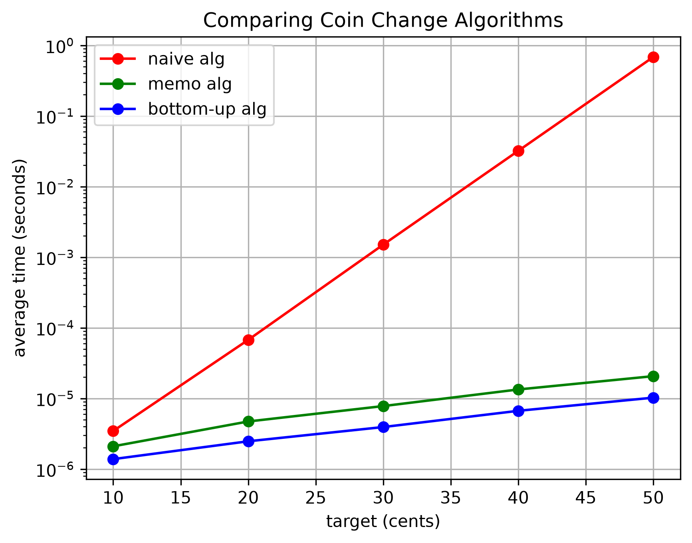

# Empirical Comparison
## Explanation
For this empirical comparison, I gave each algorithm a chance to run 10 times, with the same set of coins, and with the same target. Then I took the average time of those 10 runs, and compared it to different set target amounts. I chose the target amounts of 10, 20, 30, 40, and 50 because it allowed me to compare the times as 10 cents was added to the target while also not being too much of a target that my run time would take an excessive amount of time. From the graph, we can see that the naive grows at a much greater scale than the other two. Between memo and bottom-up, bottom-up has the upper hand for a faster running time and seems to be growing at the same rate as the memo alg. This suggest they have similar running growth, but bottom-up has a faster running time. 
## Benchmark Graph
